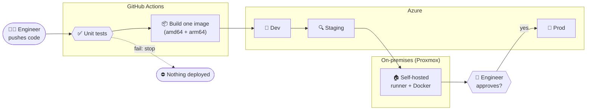

# Azure CI/CD lab: from commit to production, in the cloud and on-prem

## The scenario

A company wants a safe, repeatable way to ship software. This lab builds that
pipeline end to end:

- Every change is **tested automatically** by GitHub Actions.
- It is built **once**, then moved through **dev → staging → prod** on Azure.
- The same build also runs on an **on-premises VM** (a Proxmox home lab here), to
  show the pipeline isn't tied to a single cloud.
- Nothing reaches production until the **unit tests pass** and an **engineer
  approves** it.

The sample app is deliberately tiny, so the pipeline is the interesting part. On
Azure it runs as a container (Azure Container Apps), so there are no servers to
patch.

## How a change travels

1. An engineer pushes code to `main`.
2. **Unit tests run.** If they fail, the pipeline stops and nothing is deployed.
3. The app is **built into one container image**, which is stored in a registry.
4. That exact image is deployed to **dev**, then **staging** on Azure. After each
   deploy, an automatic check confirms the right version is running.
5. Optionally, the same image is deployed to an **on-premises VM** through a
   self-hosted runner (switched on with a repo variable).
6. The pipeline **pauses and waits for an engineer to approve**. Only then does the
   same image go to **prod**.



The same image is promoted at every step, never rebuilt, so what passed in
staging is exactly what runs in prod. Each stage's check confirms it by
asking the app for its version and comparing it to the commit that was deployed.

## What it demonstrates

- GitHub Actions with **environments**, a **required-reviewer approval gate**, and a **reusable workflow** shared by all three Azure stages
- **Build once, promote the artifact**: prod runs the digest that passed staging, never a rebuild
- **OIDC federation** from GitHub to Entra ID, with no stored cloud secrets
- **Terraform** with one state file per environment and per-environment tfvars
- A **self-hosted runner** deploying the same image to a non-Azure VM
- A **multi-arch image** (`linux/amd64` + `linux/arm64`) and a small **.NET** build/test job showing the same pipeline pattern for another stack
- **Cost guardrails**: scale to zero, a Log Analytics daily cap, and one-click destroy

## Repository layout

| Path | Purpose |
|---|---|
| `app/` | Stdlib-only Python service (`/healthz`, `/version`) and unit tests |
| `Dockerfile` | Non-root image with a healthcheck |
| `infra/` | Terraform: Log Analytics (daily cap) and a Container Apps environment and app. `envs/*.tfvars` hold the per-environment differences |
| `.github/workflows/ci.yml` | Pull-request and branch checks: tests, `terraform fmt/validate`, docker build, .NET tests |
| `.github/workflows/cd.yml` | Build once, then dev → staging → homelab → prod |
| `.github/workflows/_deploy-azure.yml` | Reusable deploy job used for all three environments |
| `.github/workflows/destroy.yml` | Manual teardown per environment (type `DESTROY` to confirm) |
| `dotnet/` | Minimal .NET library and xunit tests |
| `deploy/homelab/` | `compose.yaml` and `install-runner.sh` for the non-Azure VM |
| `scripts/` | Local checks, one-time Azure bootstrap, GitHub environment setup, final teardown |
| `docs/SETUP.md` | Step-by-step setup, security notes, cost and teardown |

## Quick start (no cloud account needed)

```bash
scripts/local-check.sh                         # unit tests, local docker build and run
cd infra && terraform init -backend=false      # downloads the provider, makes no Azure calls
terraform fmt -check -recursive && terraform validate
```

Pushing the repo to GitHub runs `ci.yml` for free on a public repo. Deploying to
Azure is a separate, optional step: see [docs/SETUP.md](docs/SETUP.md).

## Design decisions

- **Why Container Apps:** consumption pricing, scale to zero, and no cluster to operate. That keeps the focus on the pipeline.
- **Why GHCR:** the image lives next to the code, and a public package lets Azure pull it without registry credentials.
- **Why OIDC:** the federated credential subject is `repo:<owner>/<repo>:environment:<env>`, so only a job bound to that GitHub environment can obtain an Azure token. There is nothing to rotate or leak.
- **Why the gate lives on the environment:** the same job pauses in prod and runs straight through in dev. Reviewers, branch restrictions and wait timers are configured in one place instead of in YAML.
- **Why state per environment:** `dev.tfstate`, `staging.tfstate` and `prod.tfstate` in Azure Storage with Entra auth, so a bad apply in one environment cannot touch another.
- **Least privilege:** the CI identity has Contributor on its own environment's resource group only. Resource providers are registered once during bootstrap, so the provider block sets `resource_provider_registrations = "none"`.
- **Non-Azure target:** the runner makes an outbound-only connection, so the VM needs no inbound firewall rules.

## Known limitations and next steps

- One service principal with three federated credentials; a real team would use a separate identity (and ideally a subscription) per environment.
- No `terraform plan` review step before the prod approval, and `prevent_self_review` is off because this is a one-person lab.
- No vulnerability scan, SBOM or image signing yet, and actions are pinned by tag, not by commit SHA.
- No automatic rollback on a failed smoke test (Container Apps revisions would make this straightforward).
- Prod scales to zero here to save money, so its first request has a cold start. A real prod would keep one replica.

## Status

CI (Python tests, `terraform fmt/validate`, docker build, .NET tests) passes on
GitHub. The Azure deployment path and the self-hosted runner have not been
exercised end to end yet; this section will be updated when they have.
